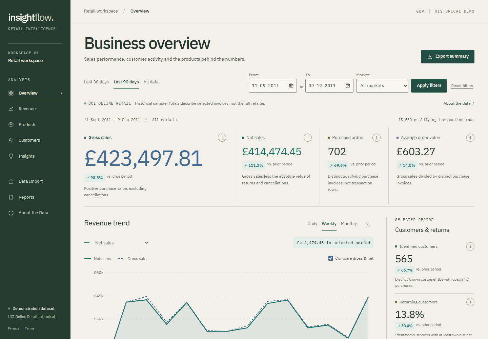

# InsightFlow

**Business intelligence, made actionable.**

InsightFlow is a working retail analytics application for exploring transaction data, understanding product/customer performance, and exporting analysis. It is designed as a freelance portfolio demonstration and a maintainable foundation for future client customization.

Small businesses often have transaction spreadsheets without a consistent way to read revenue trends, repeat purchasing or product contribution. InsightFlow turns compatible data into filtered dashboards, transparent observations and downloadable reports. It does not invent client outcomes or predictions.



## Implemented features

- Executive KPIs: gross/net sales, distinct purchase orders, average order value, identified customers, returning-customer percentage and returns/cancellations. Eligible ranges include preceding-period comparisons.
- Daily, Monday-based weekly and monthly trends; gross/net sales, order volume, basket-value trends and market comparisons. Numerical chart tables accompany tooltips.
- Top 10 products by revenue and quantity, product contribution/distribution, and searchable/sortable/paginated product reports.
- Customer intelligence: repeat purchases, revenue per identified customer, unidentified sales and five transparent RFM segments. Individual customer IDs are excluded from the UI/reports.
- Deterministic insights with calculation evidence. No LLM or predictive model is used.
- CSV import with extension/size/schema/type validation, basic aliases, a five-row preview, cleaning counts, isolated sessions and expiration/deletion. Public hosting configuration disables uploads.
- Filtered KPI/product/customer-segment CSVs and SVG chart images. Formula-like text is escaped in spreadsheet exports.
- Functional navigation, responsive mobile drawer, loading skeletons, empty/error/retry states, visible dataset provenance and draft Privacy/Terms pages.

## Stack and repository

| Layer | Verified local stack |
| --- | --- |
| Frontend | Next.js 16.4.0 App Router, React 19.3.0, TypeScript 5.9.3 strict, Tailwind 4.3.3, Recharts 3.10.1 |
| Backend | Python 3.12.6, FastAPI 0.143.0, Pandas 2.3.3, NumPy 2.5.3, Pydantic 2.14.0 |
| Validation | Pytest backend tests, Playwright desktop/mobile browser tests, ESLint, TypeScript, production build |
| Data | Prepared CSV in memory; Excel only in the offline pipeline |
| Runtime | Node 24.19.0 and pnpm 11.25.0 used locally |

Frontend dependencies are locked in `frontend/pnpm-lock.yaml`. Backend exact versions are in `backend/requirements-lock.txt`; `requirements.txt` documents top-level compatibility ranges. Self-hosted IBM Plex fonts avoid runtime Google Fonts requests. There is no database, job queue, advertising tracker or AI API dependency.

```text
frontend/app/               App Router pages, layout, styles
frontend/components/       Shell, filters, KPIs, charts, tables, imports
frontend/lib/              Typed API, response types, formatters
frontend/tests/            Browser integration tests
backend/app/main.py        Typed endpoints and API orchestration
backend/app/services/      Validation, analytics, RFM, insights
backend/app/core/          Isolated sessions, request limits
backend/tests/             Calculation and API tests
data/sample/               Attributed, processed demonstration data
scripts/                   Reproducible preparation and benchmarking
docs/                      Architecture, metrics, deployment and portfolio material
```

See [architecture](docs/architecture.md) for the request/data flow and [metrics](docs/metrics.md) for exact definitions.

The [phase-by-phase build walkthrough](docs/learning-guide.md) explains the modules, why they exist, how to verify them and the Windows setup issues resolved during development.

## Run on this Windows workspace

Dependencies are already installed. Use two PowerShell windows. If services are already running, simply open [the dashboard](http://127.0.0.1:3000/overview).

**Terminal 1: backend**

```powershell
Set-Location 'C:\Users\sidda\Downloads\INSIGHTFLOW'
$env:ALLOWED_ORIGINS = 'http://localhost:3000,http://127.0.0.1:3000'
$env:ENABLE_UPLOADS = 'true'
.\.venv\Scripts\python.exe -m uvicorn app.main:app --app-dir backend --host 127.0.0.1 --port 8000 --reload
```

**Terminal 2: frontend**

```powershell
Set-Location 'C:\Users\sidda\Downloads\INSIGHTFLOW\frontend'
$env:NEXT_PUBLIC_API_URL = 'http://localhost:8000'
& 'C:\Users\sidda\.cache\codex-runtimes\codex-primary-runtime\dependencies\bin\fallback\pnpm.cmd' dev
```

Open http://127.0.0.1:3000/overview. API health: http://127.0.0.1:8000/health. Interactive API docs: http://127.0.0.1:8000/docs. Stop terminal-started services with Ctrl+C. A port-in-use error means another service instance is already running; do not launch a duplicate.

To run the production frontend after a build, replace `dev` with `start`.

## Install on another machine

Install a supported Node.js version with npm, Python 3.11+ (3.12 was tested), pnpm 11.25.0 and a modern browser. Clone/download the repository, then run from its root:

```powershell
python -m venv .venv
.\.venv\Scripts\python.exe -m pip install -r backend\requirements-lock.txt
npm install -g pnpm@11.25.0
Set-Location frontend
pnpm install --frozen-lockfile
Copy-Item .env.example .env.local
pnpm dev
```

Start the backend in a separate terminal with the earlier uvicorn command, replacing the workspace path as appropriate. Calling the virtual environment's Python directly avoids PowerShell activation-policy issues. Backend variables must be set in the shell or host settings; the backend does not automatically read `.env` files.

For restricted Windows environments where Python's temporary-folder bootstrap fails, create a project-local temporary directory before creating the virtual environment:

```powershell
New-Item -ItemType Directory -Force .tmp | Out-Null
$env:TEMP = Join-Path (Get-Location) '.tmp'
$env:TMP = $env:TEMP
python -m venv .venv
```

## Data and methodology

The bundled demo is a real, cleaned, deterministic 1/10 whole-invoice sample of **UCI Online Retail**, with 49,086 rows and 2,376 invoices. It covers the historical period December 2010 to December 2011. Sample totals are not full-retailer totals or current business results. Customer IDs are pseudonymized in the packaged sample. Raw and full processed files are excluded from Git.

Citation: Chen, D. (2015). *Online Retail* [Dataset]. UCI Machine Learning Repository. [DOI: 10.24432/C5BW33](https://doi.org/10.24432/C5BW33). [Dataset source](https://archive.ics.uci.edu/dataset/352/online+retail). [CC BY 4.0](https://creativecommons.org/licenses/by/4.0/).

Original workbook cleaning: 541,909 input rows, 5,268 duplicates removed, 2,512 invalid rows excluded and 534,129 rows retained. The full source quality report and the active sample quality report are separate. See [data preparation](data/README.md) for reproduction and adaptations.

Gross sales use positive purchase lines. Returns are C-prefixed invoices or negative quantities and contribute negative absolute values. Net sales sum signed values. AOV divides gross sales by distinct valid purchase invoices. Missing customer IDs remain in financial totals but never become invented customers. Comparisons use preceding equal-length calendar ranges. RFM scores are documented descriptive thresholds, not an ML model.

To reproduce the prepared sample, from the project root:

```powershell
.\.venv\Scripts\python.exe scripts\prepare_data.py --download
```

If external download is unavailable, `scripts/generate_sample.py` can deliberately replace the sample with seed-42 synthetic data. Its provenance and interface labels explicitly say synthetic. Restart the backend after changing prepared data. Never represent synthetic outcomes as real historical results.

## Verification

Actual results and timings are in [verification](docs/verification.md). Tests use hand-checkable fixtures and exercise real API/browser behavior.

From the project root:

```powershell
.\.venv\Scripts\python.exe -m pytest backend\tests -q
.\.venv\Scripts\python.exe scripts\benchmark_api.py
Set-Location frontend
pnpm lint
pnpm typecheck
pnpm build
```

For browser tests, run both services on ports 3000/8000, then `pnpm test` inside `frontend`. The configuration uses installed Microsoft Edge for desktop, a 1024×900 tablet viewport and a 390×844 mobile viewport. To use Playwright Chromium on another OS, change the browser channel in `playwright.config.ts` and install that browser. Screenshot artifacts are captured in `docs/screenshots/`. You can format frontend source with `pnpm format`.

The [UI/UX redesign audit](docs/design-audit.md) records the design system, improvements across all ten pages, data-preservation checks and remaining limitations. With both services running, `node scripts/ui_audit.cjs` and `node scripts/ui_audit.cjs --edges` capture all routes at six widths from 320 to 1920 px. `node scripts/ui_state_audit.cjs` captures loading, error, empty and export-success interfaces.

The [analytical color system](docs/chart-system.md) documents the chart palette, semantic series, category highlights, legends, tooltips and self-contained SVG downloads. `node scripts/chart_visual_audit.cjs` reviews the four chart pages at six widths and captures hover states and standalone SVG previews.

## Deployment

Render backend configuration is in `render.yaml`; Vercel uses the `frontend` directory with its Next.js framework settings. Set `NEXT_PUBLIC_API_URL` at frontend build time and exact `ALLOWED_ORIGINS` on the API. See the [deployment guide](docs/deployment.md) for setup, current provider restrictions, costs and live smoke tests.

This repository contains the application source and local verification results. A hosted deployment has not been configured; publishing the source to GitHub does not start a live website. Vercel Hobby is restricted to non-commercial personal use; Render free services sleep after inactivity. Those constraints are documented rather than assumed away.

## Limits and future work

- Portfolio/MVP scope: not an audited accounting system and not certified for confidential commercial data.
- GBP only; no tax, shipping, margin, inventory, currency conversion or original-invoice return reconciliation.
- Historical sample and illustrative RFM thresholds; sampling reduces observed repeat-purchase history. Internal date gaps are treated as no recorded activity rather than proven coverage.
- Uploads: ≤5 MB / 100,000 rows; memory-only, normally 30 minutes; tokens disappear on browser reload; expiry cleanup occurs on the next store operation. Framework-managed temporary multipart spooling can occur. One API worker is required. Cache/process overhead is additional to the dataframe memory limit.
- Public uploads are disabled in deployment configuration. Authentication, rate limits and security/legal review are required before real client use.
- Chart export is SVG, not PNG or PDF. No account, automatic schedules, permanent storage or predictive model is implemented.
- The verified linter is ESLint 9.39.5 because the Next.js import/React/accessibility plugins currently declare ESLint 9 peer support. The package registry marks that version deprecated. Update the toolchain together when compatible plugin versions are available. Starlette's current TestClient emits one `httpx` migration warning; backend assertions pass.
- Local timings do not establish hosted or concurrent performance. No live hosting result is claimed.

Future ML work should begin with simple baselines and chronological evaluation, avoid data leakage and report suitable error metrics. Possible directions: forecasting, evaluated anomaly detection, inventory intelligence and optional language explanations. These are proposals, not fabricated working features.

## Portfolio and freelancing material

[Case study](docs/portfolio-case-study.md) · [LinkedIn draft](docs/linkedin-post.md) · [Service package](docs/freelancing-package.md) · [80-second demonstration script](docs/demo-script.md)

Software is MIT licensed. Dataset assets retain CC BY 4.0 attribution. Privacy and Terms pages are drafts requiring review before commercial deployment.
