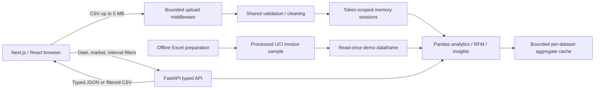

# Architecture

## Frontend

Next.js App Router with a validated `[section]` route for eight product sections and two trust pages. Root `/` redirects to `/overview`. TypeScript is strict. A React context owns the active dataset token, metadata and filters. An AbortController cancels obsolete requests. Tokens exist only in browser memory and disappear on reload. Link navigation retains the active dataset and filters. No chart contains fabricated metrics or a fallback series.

The interface uses self-hosted IBM Plex Sans and Mono, Tailwind design tokens, custom CSS, minimal custom SVG icons and Recharts. Numerical chart tables, keyboard focus, loading skeletons, API-error recovery, empty states, mobile navigation and horizontal table scrolling are implemented. Product search, sorting and pagination operate on the filtered backend product list.

`/api/dashboard` combines the results required across pages, reducing HTTP round trips. Individual metric endpoints expose the same services for API exploration. No database, Redis, job queue or ML dependency is required.

## Backend and data

`services/validation.py` centralizes cleaning. `analytics.py` defines financial calculations, filtering and grouped reports. `segmentation.py` computes descriptive RFM without returning individual customer IDs. `insights.py` builds deterministic observations. Pydantic response models define the client contract and appear in OpenAPI at `/docs`.

The original XLSX is used only by preparation. An ignored full cleaned CSV and quality report are produced, along with a packaged deterministic 1/10 whole-invoice sample. Original customer IDs are replaced by stable hashed aliases in the sample. Original/processed full data are ignored by Git. The API loads and cleans the sample once per process, then caches up to 32 filtered aggregate results per dataset. Product totals and label frequencies use vectorized group-by operations. Time-series zero buckets are generated explicitly.

## Upload lifecycle

1. Client validates CSV extension, nonzero size and 5 MB limit.
2. ASGI middleware rejects bodies beyond 5 MB plus 64 KB multipart overhead before parsing, including chunked bodies. The file itself is limited to 5 MB.
3. Backend reads at most 100,001 rows and rejects uploads beyond 100,000. Header mapping, type checks, exclusions and missing-value reports run before acceptance.
4. The validated dataframe gets an unpredictable 256-bit bearer token and an absolute expiration time. Separate sessions share no data or aggregate caches. Preview omits customer IDs.
5. API requests include the token in an Authorization header, never in a URL. Missing token means demo; invalid or expired token returns 401 and never silently falls back to another user's data.
6. Session deletion or expiry removes the dataset; expiry cleanup is lazy on the next store operation. API restart removes all sessions. Limits are 20 sessions and 128 MB of session dataframe memory by default. Cache/serialization overhead is additional.

The application does not permanently store raw uploads. Multipart temporary spooling is framework/OS managed and disclosed in Privacy. Responses have `Cache-Control: no-store` and `X-Content-Type-Options: nosniff`. CORS origins are explicit. Raw records are not logged. CSV exports escape spreadsheet formula text.

This is a single-process mechanism, not an authenticated SaaS. Run one API worker if uploads are enabled. Multiple workers/instances need sticky routing or a different storage architecture. Public deployment disables uploads by default in `render.yaml`. A production service requires authentication, rate limiting, transport/security review and agreed retention controls before processing confidential data.
