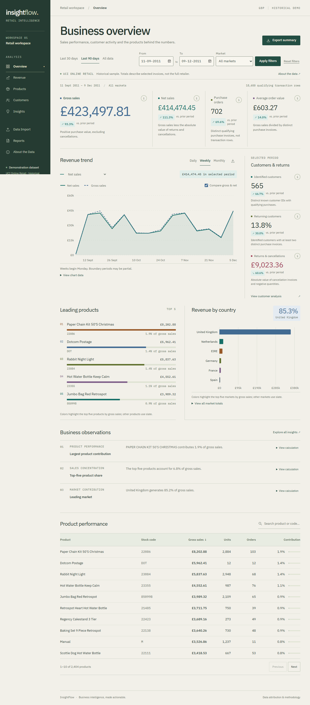
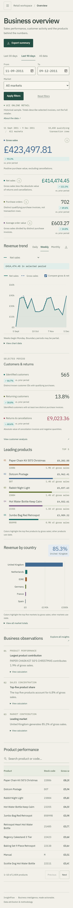

# InsightFlow: from transaction spreadsheets to actionable retail analysis

## Business problem and intended users

Small retailers and online sellers often have spreadsheets of transactions without a consistent way to read trends, repeat purchasing or product contribution. InsightFlow is a portfolio application for business owners, retail consultants and agencies who need an understandable analytical starting point. It demonstrates functionality, not a claim of client revenue improvement.

## Working solution

A Next.js/React/TypeScript frontend communicates with a FastAPI/Pandas backend. The restrained ivory, charcoal and teal interface organizes eight functional sections around executive, revenue, product and customer questions. Recharts displays backend aggregates with numerical tables. Users can filter dates and markets, inspect seven KPIs, compare eligible prior periods, search/sort products, inspect rule-based RFM segments, read calculation evidence and export CSV/SVG reports.

The original UCI Online Retail workbook has 541,909 rows. Reproducible preparation removes 5,268 duplicate rows and excludes 2,512 invalid rows under explicit rules, leaving 534,129 valid rows. A deterministic whole-invoice sample includes 49,086 rows and 2,376 invoices. Customer IDs in the packaged sample are pseudonymized. Every page labels the demo as a sample; its totals are not extrapolated to the full retailer. Missing customer identifiers remain in financial analysis and are excluded from customer counts.

Compatible CSV imports are validated, previewed and isolated by temporary bearer-token sessions. The interface discloses backend processing and temporary memory retention. Public hosting configuration disables uploads until a security review.

## Architecture and methodology

See [architecture](architecture.md) for the system diagram and [metrics](metrics.md) for exact cleaning, financial, comparison and segmentation definitions. Preparation happens offline. The API reads prepared CSV data once and uses bounded per-dataset aggregate caches. Net revenue subtracts absolute return/cancellation values. Orders count distinct invoices. RFM is descriptive rule-based scoring, without a predictive model or LLM.

## Actual interface

Screenshots are captured from the running application by browser tests; they are not interface mockups.

## Engineering challenges

- **Correct units of analysis:** invoices can have many lines. Tests verify orders and frequency count invoices, while sales sum signed line values.
- **Cancellation semantics:** both C-prefixed invoices and negative quantities are classified as returns, including positive-quantity cancellation records. A test fixture initially used a customer-like invoice name beginning with C, so it correctly became a cancellation; the fixture was corrected to use explicit purchase invoice IDs.
- **Customer missingness:** financial inclusion and customer exclusion are deliberately separate. No anonymous customer is invented.
- **Upload isolation:** session tokens, absolute expiration, deletion, row/file/memory caps and formula-safe exports protect against accidental dataset sharing and common CSV problems. Public upload processing remains disabled by deployment configuration.
- **Initial aggregation latency:** the first implementation looped through product groups. A browser test exposed a slow full-range request. Product totals and label frequencies were changed to vectorized group-by operations. Cached results reuse those aggregates.
- **Windows development restrictions:** local temporary paths resolved a virtual-environment bootstrap permission error. Package installation, sockets and browser checks required the available execution approval path. The required Next.js/FastAPI stack was retained.

## Verification and performance

Results and exact commands are recorded in [verification](verification.md). The backend suite covers revenue, net/return handling, distinct invoices, missing IDs, date filtering, all RFM segments, duplicate/invalid rows, empty results, invalid uploads, session isolation/expiry/deletion, export consistency and formula-safe CSVs. Browser checks cover the actual desktop/mobile pages, navigation, filters, loading, recovery, empty charts, upload-fed analytics and report/chart downloads. No live deployment result is claimed.

An optimized in-process measurement loaded the sample in 560 ms and built the selected 90-day dashboard in 258 ms. A subsequent live HTTP benchmark measured 2,928.5 ms for its first request and a 35.18 ms median over four cached requests, including JSON parsing. These are local single-machine measurements, not hosting or concurrency guarantees.

## Business applications and limitations

InsightFlow can support retail performance reviews, ecommerce product analysis and consultant reporting. A real client engagement would require schema/currency adaptation, business-calibrated segmentation, authorization, retention agreements and deployment review. The historical UK retail sample is not a current client dataset; it has no cost-of-goods, inventory or tax model. Returns are not reconciled to original invoices. Rules describe filtered history, not causal effects or predicted churn.

## Next developments

Potential extensions include chronological sales-forecast baselines, evaluated anomaly detection, inventory feeds, calibrated customer activity rules and optional natural-language explanations. Predictive work must define a baseline, use chronological evaluation, prevent leakage, report appropriate errors and state data limitations before claiming value.
